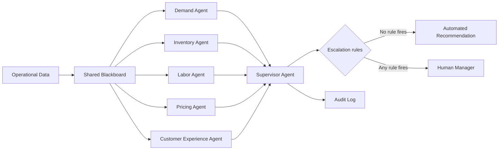

# Multi-Agent Retail Pop-up Manager

A prototype multi-agent system for running a food pop-up. Five specialized agents (demand, inventory, labor, pricing, customer experience) read a shared state and send structured messages to a Supervisor, which either issues an automated recommendation or escalates to a human manager. Every decision cycle is written to an audit log.

**The agents are rule-based, not LLM-driven.** That was a deliberate choice: the point of the project is the coordination design (shared state, a message contract, escalation rules, auditability), and deterministic agents are easy to test and explain. The message schema is the interface an LLM-backed agent could plug into. See [design notes](docs/design.md) for the reasoning, including why MARL was not used.


## Quick start

Requires Python 3.8+. No dependencies.

```bash
python main.py                          # run the Friday rush scenario
python main.py --list                   # list scenarios
python main.py --scenario normal_day    # run one scenario
python main.py --all                    # run every scenario
python -m unittest -v                   # run the tests (16)
```

Each run appends a JSON record to `audit_log.jsonl`. A sample is in [`examples/sample_audit_log.jsonl`](examples/sample_audit_log.jsonl).

## Architecture



The agents never call each other. They read the shared state, and only the Supervisor sees all their outputs. Agents are read-only: nothing takes action, everything is a recommendation.

**Message contract** (`schemas.py`): every agent returns an `AgentMessage` with `agent_name`, `issue_type`, `severity` (low, medium, high, critical), `recommendation`, `confidence` (0 to 1), `requires_human_approval`, and `evidence`. Invalid severity or confidence raises an error.

## Escalation rules

The Supervisor escalates if **any** of these is true:

1. At least one **critical** message
2. Two or more **high** messages
3. Any message sets **requires_human_approval** (restocking, staffing changes and discounts do)
4. Any message has **confidence below 0.70**

Otherwise it returns `AUTO_RECOMMEND`. The reasons that fired are returned and logged.

## Scenarios and results

| Scenario | Decision | Reason |
|---|---|---|
| `friday_rush` | Escalate | Critical stockout, 3 high alerts, approval requests |
| `high_demand_low_inventory` | Escalate | Critical stockout |
| `critical_stockout` | Escalate | Critical stockout |
| `high_wait_low_staffing` | Escalate | 2 high alerts + staffing approval |
| `low_demand_high_inventory` | Escalate | Discount proposal needs approval |
| `conflicting_pricing_and_demand` | Escalate | Discount proposal needs approval |
| `normal_day` | Auto-recommend | No rule fires |

Output of `python main.py` (Friday 6 PM, rain, nearby event, 55 expected customers, 8 units of dough, 2 staff, 18 minute wait):

```
Agent: DemandAgent              Severity: high      Expected demand is high. Prepare for increased orders.
Agent: InventoryAgent           Severity: critical  Restock pizza dough immediately.
Agent: LaborAgent               Severity: high      Add one more staff member during the rush period.
Agent: PricingAgent             Severity: low       Do not discount. Demand is strong enough.
Agent: CustomerExperienceAgent  Severity: high      Reduce wait time and communicate delays to customers.

Decision: ESCALATE_TO_HUMAN
Reason: critical alert from InventoryAgent; 3 high-severity alerts (DemandAgent, LaborAgent,
        CustomerExperienceAgent); human approval requested by InventoryAgent, LaborAgent
```

(Condensed for readability; run the command for the full output.)

## Known limitations

- **No conflict detection or resolution.** When agents disagree (for example demand says "prepare for a rush" while pricing says "discount"), the Supervisor escalates only if a rule fires. It does not compare recommendations. In the `conflicting_pricing_and_demand` test it escalates only because discounts need approval.
- **Correlated alerts inflate escalation.** In the Friday rush, four of the five alerts trace back to the same surge, and the Supervisor counts them separately. Root-cause deduplication is the obvious next step.
- **Narrow checks.** `InventoryAgent` only monitors pizza dough, and `DemandAgent` matches the exact string "Friday 6 PM" plus a nearby-event flag.
- **Hard-coded thresholds and mock data.** Nothing is tuned or learned, and there are no real data feeds.
- **Advisory only.** There is no human approval step, no action execution and no rollback. The escalation is the end of the pipeline.
- **Evaluation.** Tests check that the rules behave as designed. Outcome metrics (forecast accuracy, stockout rate, manager trust) are planned and need real or simulated data. See [evaluation](docs/evaluation.md).

## Repository layout

```
main.py                 run a scenario, print results, write the audit log
agents.py               the five specialized agents
supervisor.py           escalation rules
schemas.py              AgentMessage (validated)
simulation.py           mock blackboard states / scenarios
test_scenarios.py       unit tests
examples/               sample audit log
docs/design.md          problem, why multi-agent, coordination choice, emergent behavior, MARL
docs/evaluation.md      tests that exist and metrics that are planned
docs/safety_governance.md   human-in-the-loop controls, audit logs, failure cases (with status)
docs/architecture.mmd   diagram source
```
